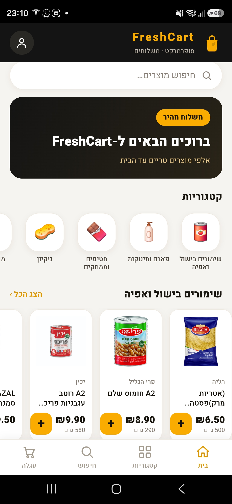
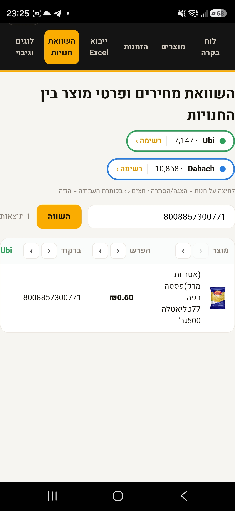
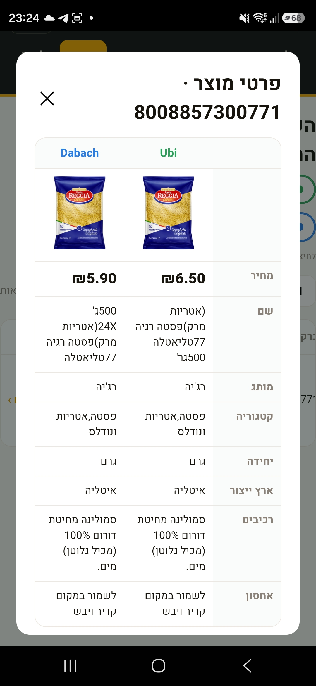

# FreshCart
# NOTE: THIS IS A DEMO OF THE REAL APP.
A full grocery‑delivery platform, built end to end: a customer storefront, a staff back‑office
console, a Node + SQLite backend, and two installable Android apps — self‑hosted and running 24/7.



## What it does

### Customer storefront
- Browse thousands of products by category, search, and add to a cart
- Log in with just a phone number — a one‑time SMS code, no passwords
- Checkout and view past orders
- Installable on Android or usable straight in the browser

### Manager console (`/admin`)
- **Orders** — see live orders, edit line items, change status, cancel
- **Products** — edit prices, stock and visibility inline
- **Cross‑store price comparison** — pulls product catalogs from other supermarkets and lines
  them up side by side: price, brand, ingredients, images and more, so you can see where each
  item is cheaper
- **Bulk editing from Excel** — download a template, upload your changes, preview *exactly* what
  will change, apply it in one transaction, and undo a whole batch with one click
- **ERP‑ready** — a sync hook so prices and stock can come from an ERP instead of by hand
- Every change is written to an audit log

| Price comparison | Product detail across stores |
|---|---|
|  |  |

## Tech

- **Backend** — Node.js + Express, a compact single‑file API
- **Database** — SQLite via `better-sqlite3`. The app was originally written for SQL Server;
  `server/db.js` is a small **compatibility layer** that re‑implements just the slice of the
  `mssql` API the code uses (`Transaction`, `Request`, typed inputs, `query`) and translates the
  T‑SQL to SQLite on the fly — so the route code didn't have to change
- **Front‑ends** — plain vanilla JS, no framework; installable PWA + service worker
- **Mobile** — Android WebView wrappers built **without Gradle** (javac → d8 → aapt2 → zipalign →
  apksigner); each app is just a thin shell around the website, so the site updates without a reinstall
- **Hosting** — runs 24/7 on a Raspberry Pi, exposed through a Cloudflare tunnel

## Run it locally

```bash
npm install
npm run seed     # builds a small sample catalog at data/freshcart.db
npm start        # http://localhost:4000   (admin console at /admin)
```

The admin password comes from `ADMIN_PASSWORD` (see `.env.example`); if it's unset, a random one
is printed to the console on boot. Product images are optional — if the images folder is empty the
UI falls back to category emoji.

## Project structure

```
server/              Express API + the SQLite compatibility layer (db.js) + branding
public/storefront/   customer PWA (vanilla JS)
public/admin/        manager console (vanilla JS)
android/storefront/  Android wrapper for the storefront
android/manager/     Android wrapper for the admin
scripts/             sample seed + maintenance helpers
docs/screenshots/    images used in this README
```

## Building the Android apps

Each folder under `android/` is a WebView wrapper. Point it at your own URL in
`src/.../MainActivity.java`, then run `build.ps1` (needs the Android SDK build‑tools). The built
APK is served by the app itself (there's an install page at `/app`).

## Notes

- The seed ships **synthetic sample data** — the real deployment uses a private catalog.
- The price‑comparison tool lives behind the admin login.

## License

MIT — see [LICENSE](LICENSE).
